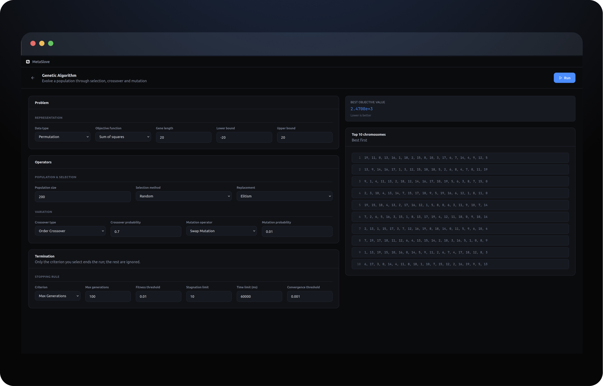
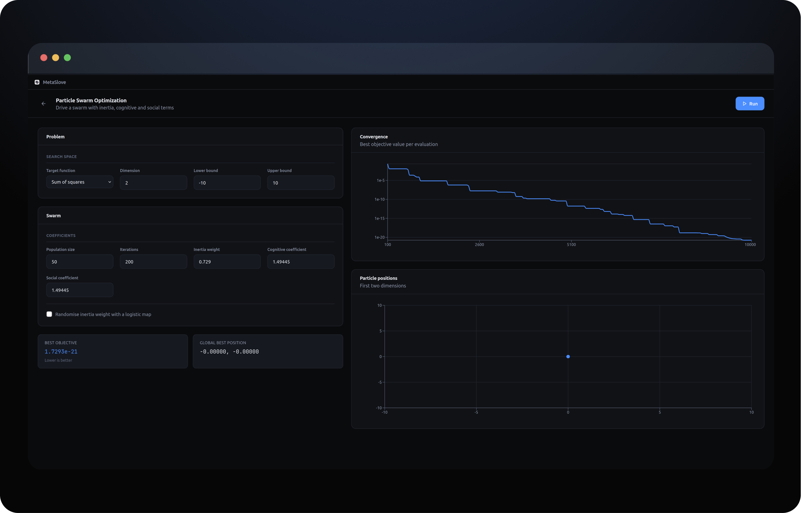
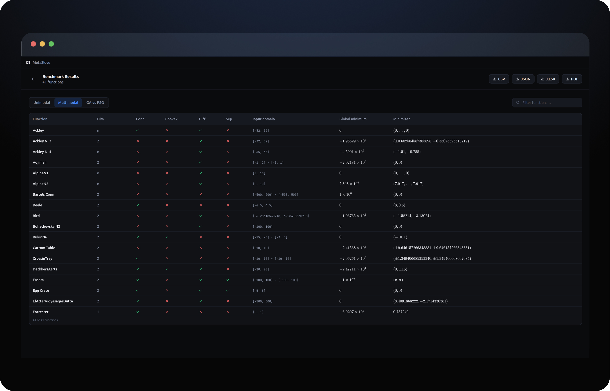

# MetaSolve

A desktop app for running and comparing two metaheuristic optimizers — a **Genetic Algorithm** and **Particle Swarm Optimization** — against a suite of 67 standard benchmark functions.

Configure every operator and coefficient from the UI, watch a run converge, and compare both algorithms under a matched evaluation budget. Built with React, Vite and Tauri.



---

## Contents

- [Requirements](#requirements)
- [Running the app](#running-the-app)
- [Using the app](#using-the-app)
  - [Genetic Algorithm](#genetic-algorithm)
  - [Particle Swarm Optimization](#particle-swarm-optimization)
  - [Benchmark Results](#benchmark-results)
- [Regenerating the benchmark data](#regenerating-the-benchmark-data)
- [Project layout](#project-layout)

---

## Requirements

| | |
|---|---|
| **Node.js** | 18 or newer (developed on 24) |
| **Rust + Cargo** | only needed for the desktop build — see [Tauri prerequisites](https://tauri.app/start/prerequisites/) |

The browser-based dev server needs Node alone. Rust is only required when you package the app with Tauri.

## Running the app

```bash
npm install
```

**In the browser** — fastest for development:

```bash
npm run dev
```

Then open <http://localhost:1420>. The port is fixed, because Tauri expects it.

> The window controls in the title bar (minimise / maximise / close) only appear inside the desktop shell. In a plain browser tab they're hidden rather than rendered as dead buttons.

**As a desktop app:**

```bash
npm run tauri dev     # development, with hot reload
npm run tauri build   # produce a distributable bundle
```

`npm run build` on its own just builds the web assets into `dist/`.

---

## Using the app

The home screen links to the three sections. Each algorithm page follows the same shape: **parameters on the left, results on the right, and a Run button in the header.** Invalid settings are reported in a banner above the parameters — nothing starts until the configuration is valid.

### Genetic Algorithm

Evolves a population of chromosomes through selection, crossover and mutation.

**1. Pick a representation.** The **Data type** drives everything else — the crossover and mutation dropdowns only offer operators valid for the type you chose:

| Data type | Crossover | Mutation |
|---|---|---|
| Binary | Single Point, Two Point, Uniform | Bit Flip |
| Permutation | Order Crossover, Cycle Recombination | Swap, Insert, Scramble, Inversion |
| Real Number | Simple, Simple Arithmetic, Whole Arithmetic, BL-x | Complementary, Gaussian |

**2. Choose an objective function** — Sum of squares, Rosenbrock, Rastrigin, or the Traveling Salesman Problem. All four are **minimised**, so lower is better.

> The Traveling Salesman Problem requires the **Permutation** data type; the app will tell you if the two don't match. TSP generates 100 random cities per run, so the tour length isn't comparable between runs.

**3. Set the population and operators** — population size, selection method (Random, Roulette Wheel, Rank Base, Tournament, Truncation), replacement strategy (Elitism, Generational, Steady State, Tournament, Fitness Based), and the crossover/mutation probabilities, which must each lie between 0 and 1.

**4. Choose when to stop.** Only the criterion you select in the **Criterion** dropdown ends the run — the other fields on that card are ignored. For example, picking `Max Generations` means `Time limit` has no effect.

| Criterion | Stops when |
|---|---|
| Max Generations | the generation count is reached |
| Stagnation Limit | the best value hasn't improved for N generations |
| Fitness Threshold Stop | the best objective value drops to or below the threshold |
| Time Limit | the elapsed time (ms) is reached |
| Population Convergence | the population's spread falls under the threshold |

**5. Press Run.** The right-hand panel shows the best objective value found and the ten best chromosomes, best first.

### Particle Swarm Optimization



Drives a swarm of particles through the search space using inertia, cognitive and social terms.

**Problem** — target function (Sum of squares, Rosenbrock, Rastrigin), the number of dimensions, and the bounds of the search box.

**Swarm** — population size, iterations, and the three coefficients: inertia weight `W`, cognitive `c1` and social `c2`. Ticking **Randomise inertia weight with a logistic map** replaces the fixed `W` with a chaotic value per dimension and disables the inertia field.

> One iteration evaluates every particle once, so the total work is `iterations × population size`. The defaults (200 × 50) give 10,000 evaluations.

Two charts update as the run proceeds:

- **Convergence** — best objective value against evaluations. The y-axis is logarithmic, since a good run spans many orders of magnitude; it falls back to linear if the objective ever reaches exactly zero.
- **Particle positions** — where the swarm is in the first two dimensions. Only drawn for 1- or 2-dimensional problems; above that there's nothing meaningful to plot.

Below the parameters you get the best objective value and the global best position.

### Benchmark Results



Three views of the benchmark suite, switched with the segmented control:

- **Unimodal** (26 functions) and **Multimodal** (41) — each function's dimensionality, continuity, convexity, differentiability and separability, plus its input domain, global minimum and minimizer.
- **GA vs PSO** (67) — mean and variance of each algorithm's result over 20 runs, alongside the error relative to the function's known global minimum.

Click any column header to sort, and use the filter box to search. The four buttons in the header export **exactly what's on screen** — the active view, in CSV, JSON, XLSX or PDF.

> **The shipped comparison data is stale.** `src/Algorithms/results/*.json` predates recent fixes to the algorithms, so the GA column in particular should not be trusted until you regenerate it. See below.

---

## Regenerating the benchmark data

The sweep runs outside the UI, across 8 worker threads. It must be started **from the `Benchmarks` directory**, because the master resolves the worker path relative to the working directory:

```bash
cd src/Algorithms/Benchmarks
node benchmarks-master.js PSO       # or: Genetic
```

Each run writes to `src/Algorithms/Benchmarks/data/<optimizer>-<threadId>-data.json`. To publish results to the app, merge those per-thread files into `src/Algorithms/results/pso.json` or `ga.json`, which is what the comparison table reads.

Both optimizers are held to the **same budget of 60,000 objective evaluations**, 20 runs per function, so the comparison is meaningful. Each function is run at its own published dimensionality and input domain (from `problem-specs.js`) rather than a single blanket setting — scalable functions default to 30 dimensions.

This takes a long time. Expect to leave it running.

---

## Project layout

```
src/
├── App.jsx                     Home screen
├── main.jsx                    Routes
├── titlebar.jsx                Custom window chrome (Tauri)
├── index.css                   Design tokens — colours, type, radii
├── components/
│   ├── ui.jsx                  PageShell, Card, Field, Button, Stat, …
│   └── DataTable.jsx           Sortable, filterable table
├── pages/
│   ├── ga.jsx                  Genetic Algorithm
│   ├── pso.jsx                 Particle Swarm Optimization
│   └── tables.jsx              All three benchmark views
└── Algorithms/
    ├── Genetic Algorithm/      Engine: selection, crossover, mutation,
    │                           replacement, stop conditions
    ├── PSO/pso.js              Swarm engine
    ├── Benchmarks/
    │   ├── main.js             The 67 objective functions
    │   ├── functions.json      Their published properties
    │   ├── problem-specs.js    Per-function dimension + domain
    │   ├── benchmarks-master.js  Thread pool that drives a sweep
    │   └── worker.js           Runs one chunk of functions
    └── results/                Published sweep results (ga.json, pso.json)
```

Every page is assembled from the primitives in `components/ui.jsx`, and all colours come from the tokens at the top of `index.css` — change them there and the whole app follows.

**A note on conventions:** the engines *minimise*. Every objective function returns a raw value where lower is better, and the selection operators convert to fitness internally. If you add a function, return the raw objective — don't negate it or wrap it in `1/(1+f)`.
